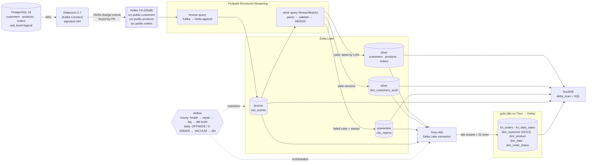

# DeltaLake: a streaming CDC lakehouse

Captures every row-level change from PostgreSQL with **Debezium**, streams it
through **Kafka**, and processes it with **PySpark Structured Streaming** into
**Delta Lake** tables in a medallion layout:

* **bronze**: raw change events, exactly once;
* **silver**: validated current-state tables;
* **quarantine**: invalid records, each with the reason it failed;
* **SCD Type 2** customer history;
* **gold**: a star schema (facts + dimensions) built by **dbt** on Trino,
  also stored as Delta tables, with 31 dbt tests.

**Airflow** orchestrates the batch work around the stream: hourly health and
lag checks, Debezium auto-repair and the dbt build, plus daily compaction,
Z-ordering and vacuum. The same Delta tables are queried with plain SQL from two engines that never
touch Spark: **DuckDB** (in-process) and **Trino** (distributed SQL with a
catalog). The two agree exactly. A failure-injection suite crashes each
component under load and proves the lake still reconciles exactly with
Postgres. The design follows the Delta Lake lakehouse architecture
(Armbrust et al., VLDB 2020).

## Measured results

Measured on a MacBook (Apple silicon, 24 GB) with Docker via OrbStack, Spark
in `local[4]` mode, and the lake on local disk. Full report in
[`reports/RESULTS.md`](reports/RESULTS.md).

| Metric | Result |
|---|---|
| **End-to-end latency**, Postgres commit → queryable in silver + SCD2 (100 actions/s, 16.6k events) | p50 **13.0 s**, p95 16.8 s, max 18.7 s |
| ...of which Postgres → Kafka (Debezium) | p50 0.49 s, p95 0.85 s |
| ...of which Postgres → bronze micro-batch | p50 1.4 s, p95 2.7 s |
| Silver micro-batch duration (validate + 4 MERGEs + quarantine MERGE) | p50 6.8 s, p95 8.2 s |
| **Throughput**, one 58,510-row transaction | fully in silver 6.7 s after commit, **≈8,700 events/s** |
| Throughput, unthrottled generator for 60 s | 443 events/s end to end, capped by the generator (508 events/s); caught up 8.8 s after load stopped |
| **Reconciliation** after 490,432 change events | **exact**: Kafka messages = bronze rows, unique offsets; every valid source row identical in silver; every invalid latest change in quarantine; SCD2 current = silver |
| **Failure injection**, 7 scenarios (below) | **7/7 recovered and reconciled exactly** |
| **Full replay**: empty lake rebuilt from Kafka offset 0 (~243k events) | reconciled exactly in 33 s |
| **Trino vs DuckDB**, 11 aggregates over the same tables | identical, including revenue to the cent |
| **dbt build** (9 models, 31 tests) on the gold star schema | 40/40 passing; gold totals identical in Trino, DuckDB and Spark |
| **Airflow**: `lakehouse_hourly` and `lakehouse_maintenance` executed with `airflow dags test` | all tasks succeeded |
| **Compaction** of bronze (2,846 → 3 files) | full scans 10–15× faster on DuckDB and Trino (below) |
| Unit tests (+ 4 DAG integrity tests) | 49 passing (+4), in GitHub Actions CI |

Row counts after the benchmark:

| Table | Rows |
|---|---|
| bronze `cdc_events` | 490,432 |
| silver `customers` / `products` / `orders` (live) | 19,466 / 4,691 / 56,706 |
| silver `dim_customers_scd2` | 71,343 versions, 19,466 current |
| quarantine `cdc_rejects` | 23,796 |

**What the numbers mean.** Debezium and Kafka add under 1 s. Most of the
latency is the silver micro-batch. Each batch costs about 7–8 s of mostly fixed
overhead, whether it holds 30 events or 15,000: it runs four Delta MERGEs, an
SCD2 history rebuild and a quarantine MERGE, each with its own Spark jobs and
Delta commit on a single machine. A change that arrives just after a batch
starts waits for that batch and the next one.

Two changes moved the number:
* Running the three tables concurrently cut p50 from 17.0 s to 12.8 s.
* Making quarantine a MERGE, to fix a bug the failure tests found, cost back
  about 0.2 s.

Big transactions amortise the fixed cost, hence about 8,700 events/s for a bulk
update. Seconds-level freshness suits analytics, but this setup is not
sub-second (see Limitations).

### Query performance: before vs after tuning

Same SQL, same data, median of 5 runs ([`reports/PERFORMANCE.md`](reports/PERFORMANCE.md)).
The tuning: bronze re-partitioned by `(source_table, event_date)`, OPTIMIZE
compaction, Z-ORDER on `customer_id`, gold `fct_orders` partitioned by
`order_date`, and VACUUM.

| Query | Files before → after | DuckDB before → after | Trino before → after |
|---|---|---|---|
| Bronze full scan | 2,846 → 3 | 155 → 10 ms (**15×**) | 318 → 30 ms (**11×**) |
| Bronze, one table, 30-min window | 2,846 → 3 | 122 → 12 ms (**10×**) | 118 → 22 ms (**5.5×**) |
| Quarantine reasons | 341 → 1 | 19 → 4 ms (**4.5×**) | 62 → 26 ms (**2.4×**) |
| Silver orders for one customer | 4 → 1 | 4 → 5 ms (0.7×) | 31 → 18 ms (1.7×) |
| SCD2 as-of for one customer | 4 → 1 | 4 → 5 ms (0.7×) | 20 → 20 ms (1.0×) |
| Gold star join | 1 → 1 | 9 → 9 ms (1.0×) | 70 → 62 ms (1.1×) |
| Gold fact, one day | 1 → 1 | 1 → 1 ms (1.0×) | 16 → 16 ms (1.1×) |

The honest reading:
* **Compaction is the whole win.** The 1-second streaming trigger had left
  thousands of tiny files in bronze.
* **Z-ordering and date partitioning measured as no gain at this size.** Every
  table fits in one file after compaction, so there is nothing to skip. All
  the data falls on one day, so there is nothing to prune.
* **The layout is still the production-correct one**; this dataset is too
  small to show it.
* **DuckDB's silver queries got slightly slower** (4 → 5 ms): one file means
  fewer parallel readers.
* Every query returned identical results before and after.

### Failure injection

`make failure` runs each scenario under live load, injects the fault, lets the
system recover, then requires the exact reconciliation to pass
([`reports/FAILURE_TESTS.md`](reports/FAILURE_TESTS.md)).

| Scenario | Fault | Recovery | Result |
|---|---|---|---|
| Spark driver killed | `SIGKILL` mid-stream, down 10 s | restart resumes from checkpoints | reconciled exactly |
| Crash `before_scd2` | driver hard-exits after the silver MERGE, before SCD2 | same batch replayed | reconciled exactly |
| Crash `after_silver` | hard exit after all MERGEs, before quarantine | same batch replayed | reconciled exactly |
| Crash `after_quarantine` | hard exit after every write, before Spark marks the batch done | same batch replayed, no-op | reconciled exactly |
| Kafka broker killed | `SIGKILL`, down 25 s | Debezium back to RUNNING 8 s after the broker; Spark's Kafka source retried in place | reconciled exactly |
| Kafka Connect killed | `SIGKILL`, down 15 s | Debezium resumed from stored offsets and re-published 183 changes, all absorbed | reconciled exactly |
| Postgres crashed | `SIGKILL`, crash recovery | replication slot survived; Debezium continued | reconciled exactly |

Crash points inside a batch use a test-only hook (`FAULT_INJECT=<point>@<batch>`
makes the driver `os._exit(137)` there), because a random kill rarely lands
between two writes of the same batch.

**Bugs the suite found, now fixed:**

1. **Quarantine stored duplicates after a Connect crash.** Debezium is
   at-least-once and re-published some changes into a *later* batch. Silver and
   SCD2 were safe, being keyed by LSN, but quarantine's `txnAppId`/`txnVersion`
   guard only deduplicates replays of the *same* batch. It is now an
   insert-only MERGE on `(table, key, LSN)`, with a regression test.
2. **Debezium sat UNASSIGNED for up to 5 minutes after a Kafka outage.**
   Kafka Connect's cooperative rebalancing waits
   `scheduled.rebalance.max.delay.ms` (default 5 min) before reassigning a lost
   worker's tasks. It is now 10 s for this single-worker setup.

Reproduce with `make measure` while the pipeline runs (raw data: `reports/results.json`).

## Architecture



| Stage | What happens | Guarantee |
|---|---|---|
| Postgres → Debezium | Logical decoding of the WAL via a replication slot; initial snapshot, then streaming | No loss (slot retains WAL until acknowledged) |
| Debezium → Kafka | One topic per table, keyed by primary key | At-least-once |
| Kafka → bronze | Raw message + Kafka coordinates, partitioned by table | Exactly-once (checkpoint + Delta sink) |
| bronze → silver | Validate, quarantine rejects, MERGE latest change per key by **LSN** | Idempotent, so replays and duplicates are no-ops |
| silver → SCD2 | Rebuild touched keys' version chains by LSN, MERGE on (key, LSN) | Handles updates, deletes, duplicates, out-of-order |
| silver → gold | dbt models on Trino write a star schema as Delta tables | 31 dbt tests gate every build |
| DuckDB / Trino | Read the Delta log and Parquet files directly | Plain SQL, no Spark; both engines agree exactly |
| Airflow | Health and lag checks, Debezium repair, dbt build, table maintenance | A failing check or dbt test fails the DAG |

## Quick start

Prerequisites: Docker (OrbStack/Docker Desktop), Python 3.11, Java 17, `make`.
On macOS: `brew install python@3.11 openjdk@17`. Spark, dbt and Airflow each
get their own virtualenv (`.venv`, `.venv-dbt`, `.venv-airflow`), so their
dependency pins never collide; `make` creates them on first use.

```bash
make up          # containers, venv, seed Postgres, register Debezium (one command)
make stream      # terminal 1: Spark pipeline (resumes from checkpoints on restart)
make generate    # terminal 2: workload (RATE=50 DURATION=120 by default)
make reconcile   # Delta tables vs Postgres, exact
make query       # example DuckDB SQL in queries/
make trino-query # Trino SQL in queries/trino/ (incl. time travel)
make trino-check # same 11 aggregates on Trino and DuckDB must match
make measure     # latency / throughput / row counts -> reports/RESULTS.md
make test        # unit tests, no Docker needed
make e2e         # end-to-end reconciliation + cross-engine tests
make dbt         # build + test the gold star schema (dbt on Trino)
make airflow-test # DAG integrity tests + run the hourly DAG once
make airflow     # Airflow UI + scheduler on http://localhost:8081
make health      # service health + pipeline lag (Kafka→bronze, bronze→silver)
make maintenance # OPTIMIZE / Z-ORDER every Delta table
make failure     # failure-injection suite (stop `make stream` first), ~10 min
make demo        # up + pipeline in background + workload + reconcile + queries
make clean       # stop containers, delete volumes and the local lake
```

Ports: Postgres `5433`, Kafka `9092`, Kafka Connect `8083`, Trino `8080`, Airflow `8081`.

## What's inside

**Source and workload.** `sql/schema.sql` defines a small shop schema.
`generator/generate.py` keeps inserting, updating and deleting rows: orders
move through `placed → paid → shipped → delivered`, there are cancellations,
customers change tier, country and email, and customer deletes cascade to
orders. About 3% of writes deliberately break a business rule.

**CDC.** `connectors/postgres-source.json`: the `pgoutput` plugin,
`REPLICA IDENTITY FULL` (complete before-images for deletes), decimals as exact
strings, and 3 partitions per topic.

**Streaming** (`src/lakehouse/jobs/pipeline.py`). Two queries run in one Spark
app. *bronze* (Kafka → Delta, 1 s trigger) and *silver* (bronze Delta stream →
`foreachBatch`, 2 s trigger). Each silver micro-batch:

1. parses the Debezium envelope per table;
2. evaluates the data-quality rules;
3. writes rejects to quarantine (insert-only MERGE on table, key and LSN);
4. MERGEs valid changes into silver, keeping the latest per key by LSN and
   updating only when the incoming LSN is higher (soft deletes);
5. MERGEs into SCD2.

The three tables run concurrently in driver threads. In supervise mode (the
local default), a failed query is restarted from its checkpoints with
exponential backoff.

**Data quality** (`src/lakehouse/quality.py`): named rules per table, such as
email format, ISO-2 country, allowed tier and status, non-negative price,
positive quantity, and castable timestamps. NULL counts as a failure. Every
failure is recorded with its offending value, e.g.
`email_format: email='ava_at_example.com'`. Deletes are judged on the key only.

**SCD Type 2** (`src/lakehouse/scd2.py`): `dim_customers_scd2` with
`valid_from` / `valid_to` (half-open, source commit time), `is_current`,
`is_deleted` (tombstones) and `_lsn`. Late events are slotted into the middle
of the history by recomputing the version chain, rather than by
"close current row, append".

**Query layer** (`src/lakehouse/query.py`, `queries/`): layer row counts, CDC
activity, revenue by country, top products, order funnel, **revenue by the
tier customers had at order time** (a point-in-time join against SCD2), **customer
as of a timestamp**, most-changed customers, and quarantine reasons.

**Trino** (`src/lakehouse/trino_query.py`, `queries/trino/`, `trino/catalog/`)
reads the same files through its Delta Lake connector. Tables are registered,
not copied, into a file-based metastore with `system.register_table`. The
queries include the SCD2 point-in-time join and Delta time travel
(`FOR VERSION AS OF`).

```bash
make query
.venv/bin/python -m lakehouse.query queries/07_customer_as_of.sql \
    --var customer_id=42 --var "as_of=2026-11-10 18:00:00+00"
```

**Tests.**
* `tests/unit` (Spark local mode, no Docker, run in GitHub Actions): every DQ
  rule, NULL handling, delete semantics, invalid-never-in-silver,
  latest-by-LSN, late events, replay idempotence, SCD2 chains/deletes/
  duplicates/out-of-order/point-in-time, a property test that shuffles,
  duplicates and re-batches random histories, and a batch-replay test of the
  whole micro-batch function.
* `tests/e2e/test_reconcile.py` (`make e2e`) runs the generator, then checks
  that the lake reconciles **exactly** with Postgres. It checks these:
  - bronze count equals the Kafka message count, with unique offsets;
  - every row whose latest change is valid is identical in silver;
  - every row whose latest change is invalid is in quarantine;
  - no quarantined change is in silver;
  - SCD2 current rows equal silver, and its intervals chain.
* `tests/e2e/test_cross_engine.py`: Trino and DuckDB return identical
  aggregates.
* `tests/failure/` (`make failure`): the 7 failure-injection scenarios above.

**Gold star schema** (`dbt/`). dbt-trino builds Delta tables in `lake/gold`,
which Spark and DuckDB read too; all three engines return identical totals.

| Model | Grain / role |
|---|---|
| `fct_orders` | one row per live order; measures quantity, amount, net revenue; partitioned by `order_date` |
| `fct_daily_sales` | date × product × customer tier at order time |
| `dim_customer` | **SCD2**: one row per customer version, with a surrogate key |
| `dim_product`, `dim_date`, `dim_order_status` | current product attributes, calendar, status lookup |

* **Facts join the customer version valid when the order was placed**: a
  point-in-time join on `valid_from`/`valid_to`, so revenue by tier is
  attributed to the tier at the time.
* Orders with no valid customer version point at the Kimball **unknown
  member** (`-1`), rather than being dropped.
* **dbt tests (31)**: `unique`/`not_null`/`relationships`/`accepted_values` on
  every key, plus custom tests:
  - no overlapping SCD2 intervals;
  - one current version per customer;
  - the point-in-time key really is valid at order time;
  - the daily fact adds up to the order fact;
  - the order fact reconciles with silver.
* **The silver reconciliation test stays exact while the stream keeps
  writing.** It compares only silver rows at or below the highest LSN the fact
  saw (an LSN watermark), and any row changed since then has a higher LSN.

**Orchestration** (`airflow/dags/lakehouse_dags.py`). The stream is a
long-running Spark app (on Databricks, a continuous job), so Airflow schedules
the batch work around it rather than running it:
* `lakehouse_hourly`: services → connector repair (`scripts/ensure_connector.sh`
  restarts a FAILED/UNASSIGNED Debezium task over REST) → pipeline lag
  (`lakehouse.health`) → `dbt build`.
* `lakehouse_maintenance` (daily): OPTIMIZE/Z-ORDER → VACUUM → rebuild gold.

Tasks call project commands (`make dbt`, `python -m lakehouse.maintenance …`),
so they run the same way by hand or from any scheduler. Both DAGs were
executed end to end with `airflow dags test`, and CI checks that they import
with the expected task graph.

**Performance tuning** (`src/lakehouse/maintenance.py`,
`src/lakehouse/query_bench.py`): compaction, Z-ordering, vacuum, and a one-off
`relayout-bronze` that re-partitions bronze by `(source_table, event_date)`.
* **What the re-layout taught me:** adding the partition column is a schema
  change to the silver query's streaming source. The silver query then refused
  to restart (`DELTA_SCHEMA_CHANGED_WITH_VERSION`), while bronze kept
  ingesting.
* **The fix:** the re-layout now also restarts silver on a new checkpoint from
  the version after the rewrite, and the silver reader uses `skipChangeCommits`
  so the rewrite itself is never re-read. The recovered lake reconciled exactly.

## Design notes

* Ordering uses the **Postgres LSN**, never arrival time. Per row it is strictly
  increasing in commit order. I checked that it is unique per change on the
  captured stream, including multi-statement and cascading transactions.
* **Soft deletes** in silver remember a deleted key's LSN, so a stale event
  cannot resurrect it.
* **Bronze is raw text**, so it never fails on bad data and can be replayed
  into silver after a rule change.
* **Databricks**: [`databricks.yml`](databricks.yml) is an Asset Bundle that
  builds the package as a wheel and runs the same pipeline as a continuous job
  on DBR 15.4 LTS (Spark 3.5). `get_spark()` uses the cluster session there,
  and Kafka auth options come from `KAFKA_OPTIONS_JSON`. **This bundle has not
  been deployed**: it needs a workspace and a Kafka the workspace can reach.
  See [`databricks/README.md`](databricks/README.md).

## Limitations

* **Latency is ~13 s p50**, dominated by per-batch fixed cost, not data volume.
  Levers not yet pulled: fewer MERGEs per batch, a single Kafka → silver query
  (giving up the bronze replay hop), a real cluster, deletion vectors and
  clustering to shrink MERGE rewrites.
* **Single node.** One Kafka broker (RF=1), Spark `local[4]`, local disk. Fine for a
  demo; production needs replicated Kafka and object storage.
* **Small files come back between maintenance runs.** The 1-second bronze
  trigger recreates them; the daily DAG compacts them. Delta's
  auto-compaction is the in-stream alternative, not used here.
* **Gold is rebuilt in full every run, not incrementally.** Trino's Delta
  connector cannot INSERT or MERGE into an existing table on a local file
  system, so dbt uses drop-and-create (CTAS) and a table is briefly absent
  during its rebuild. On S3 with a single writer, or on Databricks, `fct_orders`
  would become an incremental MERGE model.
* **Partitioning and Z-ordering gains are unproven here.** The data spans one
  day and fits in one file per table (see the performance table).
* **JSON, no schema registry.** A source schema change needs `tables.py`
  updated.
* **Quarantine volume is high for products.** Once a product's price goes
  negative, every later stock update to that row also fails `price_non_negative`
  until the price is fixed. That is the correct behaviour, but it inflates the
  quarantine count.
* **Failure tests show recovery, not high availability.** With one broker and
  one Connect worker every fault is an outage, and recovery is what is tested.
  Network partitions, full disks and slow consumers are not covered.
* **Databricks is defined, not run** (see above).
* **Latency mixes two clocks** (Postgres VM vs host). The skew was measured and
  is ≤5 ms.

## Reference

M. Armbrust et al. **"Delta Lake: High-Performance ACID Table Storage over Cloud Object
Stores."** *Proceedings of the VLDB Endowment* 13(12), 2020.
[doi:10.14778/3415478.3415560](https://doi.org/10.14778/3415478.3415560)
