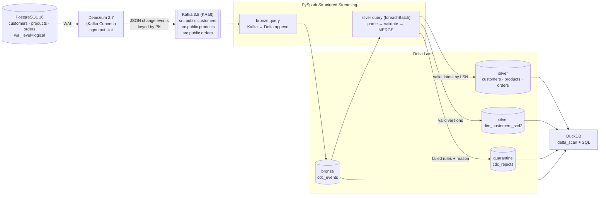

# DeltaLake: a streaming CDC lakehouse

Captures every row-level change from PostgreSQL with **Debezium**, streams it
through **Kafka**, and processes it with **PySpark Structured Streaming** into
**Delta Lake** tables in a medallion layout:

* **bronze**: raw change events, exactly once;
* **silver**: validated current-state tables;
* **quarantine**: invalid records, each with the reason it failed;
* **SCD Type 2** customer history.

The tables are then queried with plain SQL from **DuckDB**, with no Spark
involved. The design follows the Delta Lake lakehouse architecture
(Armbrust et al., VLDB 2020).

## Measured results

Measured on a MacBook (Apple silicon, 24 GB) with Docker via OrbStack, Spark
in `local[4]` mode, and the lake on local disk. Full report in
[`reports/RESULTS.md`](reports/RESULTS.md).

| Metric | Result |
|---|---|
| **End-to-end latency**, Postgres commit → queryable in silver + SCD2 (100 actions/s, 16.5k events) | p50 **12.8 s**, p95 17.2 s, max 20.1 s |
| ...of which Postgres → Kafka (Debezium) | p50 0.48 s, p95 0.85 s |
| ...of which Postgres → bronze micro-batch | p50 1.4 s, p95 2.6 s |
| Silver micro-batch duration (validate + 4 MERGEs + quarantine) | p50 6.6 s, p95 9.0 s |
| **Throughput**, one 27,825-row transaction | fully in silver 5.5 s after commit, **≈5,000 events/s** |
| Throughput, unthrottled generator for 60 s | 603 events/s end to end, capped by the generator (669 events/s); pipeline caught up 6.6 s after load stopped |
| **Reconciliation** after 196,159 change events | **exact**: Kafka messages = bronze rows = 196,159, unique offsets; every valid source row identical in silver; every invalid latest change in quarantine; SCD2 current = silver |
| Restart (graceful stop, 3,000 writes while down, restart) | resumed from checkpoints, reconciled exactly |
| Unit tests | 44 passing (CI on GitHub Actions) |

Row counts after the benchmark:

| Table | Rows |
|---|---|
| bronze `cdc_events` | 196,159 |
| silver `customers` / `products` / `orders` (live) | 9,033 / 2,159 / 26,942 |
| silver `dim_customers_scd2` | 32,499 versions, 9,033 current |
| quarantine `cdc_rejects` | 9,574 |

**What the numbers mean.** Debezium and Kafka add under 1 s. Most of the
latency is the silver micro-batch. Each batch costs about 6–9 s of mostly fixed
overhead, whether it holds 30 events or 15,000: it runs four Delta MERGEs, an
SCD2 history rebuild and a quarantine append, each with its own Spark jobs and
Delta commit on a single machine. A change that arrives just after a batch
starts waits for that batch and the next one. Running the three tables
concurrently in driver threads cut p50 from 17.0 s to 12.8 s.
Seconds-level freshness suits analytics, but this setup is not sub-second
(see Limitations).

Reproduce with `make measure` while the pipeline runs (raw data: `reports/results.json`).

## Architecture



| Stage | What happens | Guarantee |
|---|---|---|
| Postgres → Debezium | Logical decoding of the WAL via a replication slot; initial snapshot, then streaming | No loss (slot retains WAL until acknowledged) |
| Debezium → Kafka | One topic per table, keyed by primary key | At-least-once |
| Kafka → bronze | Raw message + Kafka coordinates, partitioned by table | Exactly-once (checkpoint + Delta sink) |
| bronze → silver | Validate, quarantine rejects, MERGE latest change per key by **LSN** | Idempotent, so replays and duplicates are no-ops |
| silver → SCD2 | Rebuild touched keys' version chains by LSN, MERGE on (key, LSN) | Handles updates, deletes, duplicates, out-of-order |
| DuckDB | `delta_scan()` over the same files | Plain SQL, no Spark |

## Quick start

Prerequisites: Docker (OrbStack/Docker Desktop), Python 3.11, Java 17, `make`.
On macOS: `brew install python@3.11 openjdk@17`.

```bash
make up          # containers, venv, seed Postgres, register Debezium (one command)
make stream      # terminal 1: Spark pipeline (resumes from checkpoints on restart)
make generate    # terminal 2: workload (RATE=50 DURATION=120 by default)
make reconcile   # Delta tables vs Postgres, exact
make query       # example DuckDB SQL in queries/
make measure     # latency / throughput / row counts -> reports/RESULTS.md
make test        # unit tests, no Docker needed
make e2e         # end-to-end reconciliation test
make demo        # up + pipeline in background + workload + reconcile + queries
make clean       # stop containers, delete volumes and the local lake
```

Ports: Postgres `5433`, Kafka `9092`, Kafka Connect `8083`.

## What's inside

**Source and workload.** `sql/schema.sql` defines a small shop schema.
`generator/generate.py` keeps inserting, updating and deleting rows: orders
move through `placed → paid → shipped → delivered`, there are cancellations,
customers change tier, country and email, and customer deletes cascade to
orders. About 3% of writes deliberately break a business rule.

**CDC.** `connectors/postgres-source.json`: the `pgoutput` plugin,
`REPLICA IDENTITY FULL` (complete before-images for deletes), decimals as exact
strings, and 3 partitions per topic.

**Streaming** (`src/lakehouse/jobs/pipeline.py`). Two queries run in one Spark
app. *bronze* (Kafka → Delta, 1 s trigger) and *silver* (bronze Delta stream →
`foreachBatch`, 2 s trigger). Each silver micro-batch:

1. parses the Debezium envelope per table;
2. evaluates the data-quality rules;
3. appends rejects to quarantine (idempotent via `txnAppId`/`txnVersion`);
4. MERGEs valid changes into silver, keeping the latest per key by LSN and
   updating only when the incoming LSN is higher (soft deletes);
5. MERGEs into SCD2.

**Data quality** (`src/lakehouse/quality.py`): named rules per table, such as
email format, ISO-2 country, allowed tier and status, non-negative price,
positive quantity, and castable timestamps. NULL counts as a failure. Every
failure is recorded with its offending value, e.g.
`email_format: email='ava_at_example.com'`. Deletes are judged on the key only.

**SCD Type 2** (`src/lakehouse/scd2.py`): `dim_customers_scd2` with
`valid_from` / `valid_to` (half-open, source commit time), `is_current`,
`is_deleted` (tombstones) and `_lsn`. Late events are slotted into the middle
of the history by recomputing the version chain, rather than by
"close current row, append".

**Query layer** (`src/lakehouse/query.py`, `queries/`): layer row counts, CDC
activity, revenue by country, top products, order funnel, **revenue by the
tier customers had at order time** (a point-in-time join against SCD2), **customer
as of a timestamp**, most-changed customers, and quarantine reasons.

```bash
make query
.venv/bin/python -m lakehouse.query queries/07_customer_as_of.sql \
    --var customer_id=42 --var "as_of=2026-11-10 18:00:00+00"
```

**Tests.**
* `tests/unit` (Spark local mode, no Docker, run in GitHub Actions): every DQ
  rule, NULL handling, delete semantics, invalid-never-in-silver,
  latest-by-LSN, late events, replay idempotence, SCD2 chains/deletes/
  duplicates/out-of-order/point-in-time, a property test that shuffles,
  duplicates and re-batches random histories, and a batch-replay test of the
  whole micro-batch function.
* `tests/e2e/test_reconcile.py` (`make e2e`) runs the generator, then checks
  that the lake reconciles **exactly** with Postgres. It checks these:
  - bronze count equals the Kafka message count, with unique offsets;
  - every row whose latest change is valid is identical in silver;
  - every row whose latest change is invalid is in quarantine;
  - no quarantined change is in silver;
  - SCD2 current rows equal silver, and its intervals chain.

## Design notes

* Ordering uses the **Postgres LSN**, never arrival time. Per row it is strictly
  increasing in commit order. I checked that it is unique per change on the
  captured stream, including multi-statement and cascading transactions.
* **Soft deletes** in silver remember a deleted key's LSN, so a stale event
  cannot resurrect it.
* **Bronze is raw text**, so it never fails on bad data and can be replayed
  into silver after a rule change.
* **Portable to Databricks**: transformations are plain DataFrame functions,
  `get_spark()` reuses an existing session, and all paths come from `LAKE_ROOT`
  and other environment variables.

## Limitations

* **Latency is ~13 s p50**, dominated by per-batch fixed cost, not data volume.
  Levers not yet pulled: fewer MERGEs per batch, a single Kafka → silver query
  (giving up the bronze replay hop), a real cluster, deletion vectors and
  clustering to shrink MERGE rewrites.
* **Single node.** One Kafka broker (RF=1), Spark `local[4]`, local disk. Fine for a
  demo; production needs replicated Kafka and object storage.
* **No compaction yet.** Micro-batches create many small files (about 1,200 in
  bronze after one benchmark). `OPTIMIZE`/`VACUUM` are not scheduled.
* **JSON, no schema registry.** A source schema change needs `tables.py`
  updated.
* **Quarantine volume is high for products.** Once a product's price goes
  negative, every later stock update to that row also fails `price_non_negative`
  until the price is fixed. That is the correct behaviour, but it inflates the
  quarantine count.
* **Restart was tested only as a graceful stop.** Crash and kill tests of each
  component are Part 2.
* **Latency mixes two clocks** (Postgres VM vs host). The skew was measured and
  is ≤5 ms.

## Roadmap (Part 2)

Not built yet: Trino as a second SQL engine over the same Delta tables,
failure-injection tests that crash Kafka, Connect or Spark mid-stream and
verify recovery, and a Databricks deployment.

## Reference

M. Armbrust et al. **"Delta Lake: High-Performance ACID Table Storage over Cloud Object
Stores."** *Proceedings of the VLDB Endowment* 13(12), 2020.
[doi:10.14778/3415478.3415560](https://doi.org/10.14778/3415478.3415560)
